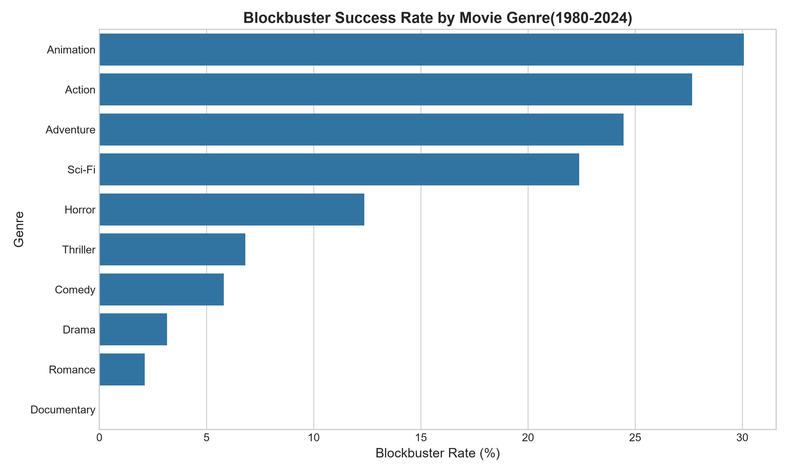
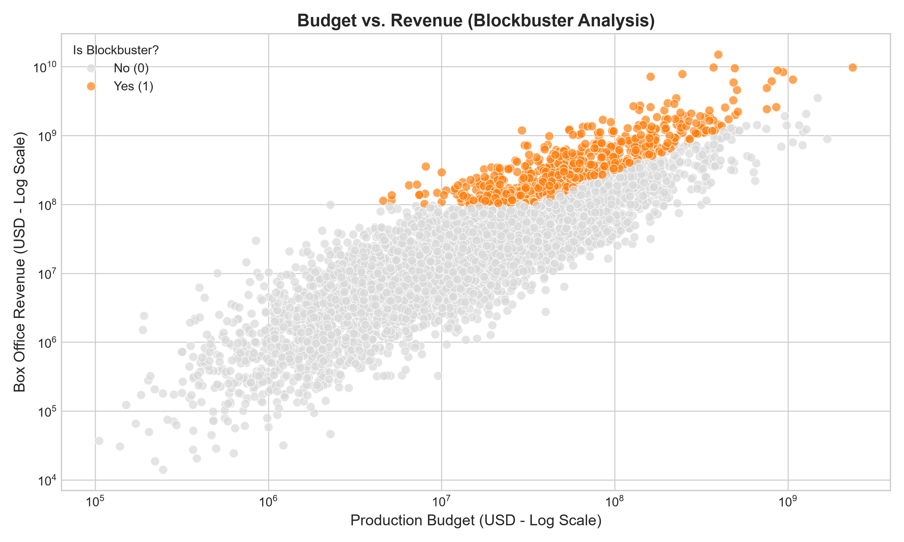

# 🎬 Hollywood Blockbuster Predictor & Box Office Analysis

> An exploratory data analysis and financial performance study evaluating 5,000 films from 1980 to 2024 to uncover the core drivers of cinematic blockbusters and return on investment (ROI).

---

## 🎯 Business Context & The Problem
In the film industry, high capital investments carry massive financial risks. Studio executives and financial analysts need to understand what separates a commercial failure from a blockbuster hit. This project examines a comprehensive synthetic dataset of 5,000 movies to answer vital business questions:
* **What defines a Blockbuster?** (Analyzing the threshold criteria: revenue > 3× budget AND > $100M).
* **Which genres yield the highest success rate and ROI?** 
* **How does initial production budget scale against box office return?**

---

## 🛠️ Tech Stack & Architecture
* **Language:** Python 3.x
* **Data Manipulation & Metrics:** Pandas, NumPy
* **Data Visualization:** Matplotlib, Seaborn
* **Environment:** VS Code, Git & GitHub

---

## 📊 Key Findings & Business Takeaways
* **Genre Performance:** *Animation* and *Action* lead the market with the highest blockbuster conversion rates (~30% and ~27% respectively), whereas dramas and romances rely on different financial models.
* **Capital Efficiency:** High budgets do not guarantee blockbuster status; strategic cost-to-revenue ratios and genre alignment play a massive role in mitigating investment risk.
* **Market Trends:** The dataset reveals clear lognormal distributions in box office revenues, reflecting real-world blockbuster economics where a small percentage of titles capture the majority of market profits.

---

## 📈 Sample Visualizations

### Blockbuster Success Rate by Genre
<p align="center">
  
</p>

### Budget vs. Revenue Correlation
<p align="center">
  
</p>

---

## 🚀 How to Run the Project
```bash
# Clone this repository
git clone [https://github.com/Thaynacarvalho98/movie-blockbuster-analysis.git](https://github.com/Thaynacarvalho98/movie-blockbuster-analysis.git)

# Install required dependencies
pip install pandas numpy matplotlib seaborn

# Run the exploratory analysis script
python analysis_blockbusters.py

⌨️ Developed by Thayná Marques | LinkedIn (https://www.linkedin.com/in/thayna-m-carvalho)
